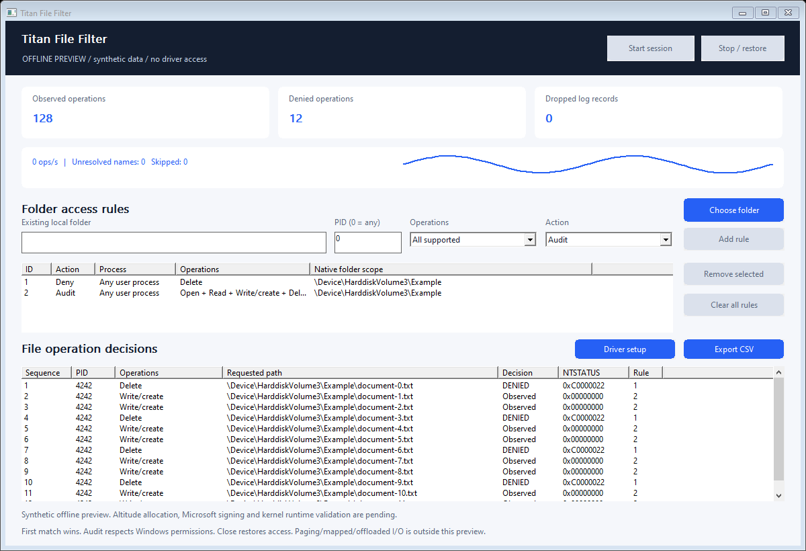

# Titan File Filter

**Windows filesystem minifilter driver, native C++ SDK and desktop file-access policy inspector.**

<!-- full-version-contact:start -->
> [!IMPORTANT]
> **Full version and commercial licensing**
>
> **Discord username: `titancsa`**
>
> Open Discord, choose **Friends > Add Friend**, enter **`titancsa`**, then send a direct message. Mention **Titan File Filter** and ask about the **full / production version, commercial use or OEM redistribution**.
>
> Include your intended use and deployment size to discuss pricing, availability and the appropriate licensing / access instructions.
<!-- full-version-contact:end -->

Build explicit folder-scoped audit and access rules for Windows applications.
Inspect the process, operation, requested path, matched rule and observed result
without reading file contents or waiting for an application to decide each I/O.



**Engineering preview:** the application, SDK and evaluation minifilter compile and
pass their documented offline checks. A genuine Microsoft altitude allocation,
driver signing and live kernel validation are still required. The download has
no installable driver or installer binary. It cannot enforce rules by itself.
See [validation](docs/VALIDATION.md) and [deployment prerequisites](docs/DEPLOYMENT.md).

## Audit and control

| Capability | Behavior |
|---|---|
| Folder scopes | Existing local NTFS/ReFS directories, normalized to native volume paths |
| Process selection | Any requesting user process, or one referenced Windows process identity |
| Ordered policy | Up to 32 rules, unique rule IDs, first matching rule wins |
| Audit | Observe registered operations and their completion status without overriding Windows permissions |
| Deny | Return access denied for matching supported requests before passing them to the filesystem |
| Operations | Open, read, write/create, delete, rename/hardlink, metadata, security changes and execute-capable opens |
| Diagnostics | Matched rule, requesting PID, policy generation, NTSTATUS, byte counts and callback interval |
| Export | Explicit local UTF-8 CSV export; no automatic upload or file-content collection |
| Recovery | Closing or crashing the owner removes this temporary policy; no background agent |

The driver uses Filter Manager. A SYSTEM/administrator-only communication
port admits one client. Process-specific rules retain a process reference rather
than selecting a future process that reuses its PID. Policy replacement is atomic;
in-flight operations can still complete under their previous policy generation.

The bounded 1,024-record ring exposes dropped logs. Exhausting logging resources
does not turn a matched Deny decision into Audit. Up to 128 completion contexts
and four control requests bound transient allocations. No file data or caller-
supplied kernel code is accepted through the SDK.

## Try the interface

Download the ZIP from [Releases](https://github.com/titanfyre/Titan-File-Filter/releases),
extract it and run:

```text
TitanFileFilter.exe --preview
FileFilterCLI.exe --preview
```

Preview data is explicitly synthetic. These commands do not load a driver,
connect to Filter Manager, monitor files or enable a policy.

After a properly allocated, Microsoft-signed and validated driver is supplied:

1. Run `FileFilterSetup.exe` and select **Install / reinstall**. Restart only if
   Windows requests it. The driver loads inactive; it is demand-start, not boot-start.
2. Run `TitanFileFilter.exe` as administrator. Choose an existing test folder.
3. Add an **Audit** rule, optionally selecting the requesting PID. Start the session
   and perform ordinary file operations in that folder.
4. Add a **Deny** rule for the desired operation. Put a narrower Audit exception
   before a broader Deny rule when appropriate. Audit leaves ACLs and other filters
   in control; it does not grant access Windows would otherwise refuse.
5. Use **Clear all rules** or **Stop / restore** to remove the policy. Closing the
   application also closes the owning port. Export only when you need a local report.

The console setup supports `/install` and `/uninstall`, validates Microsoft trust
and package identity, and never restarts Windows automatically. Source builds
without a signed opaque package cannot install a driver. Production lifecycle and
installer recovery still require validation after the altitude allocation.

## Minimal C++ integration

Add the two files `SDK/FileFilter.cpp` and `SDK/FileFilter.h` to a Windows C++17 x64
application and link `FltLib.lib`. Own a Session on one thread; serialize access
externally if necessary.

```cpp
#include "FileFilter.h"
#include <windows.h>

FileFilter::Session files;
files.Start({FileFilter::Rule(
    1, L"C:\\ExampleFolder", FF_WRITE | FF_DELETE,
    FF_DENY, GetCurrentProcessId())});

auto events = files.Read();
for (const auto& event : events) {
    auto requestedPath = FileFilter::Path(event);
    auto matchedRule = event.RuleId;
    auto ntstatus = event.Status;
}
files.SetRules({}); // Clear policy. The destructor also closes the session.
```

The folder must already exist. `Rule(id, folder, operations, action, pid)` defaults
to `FF_ALL`, `FF_AUDIT` and PID `0` (any user process). IDs must be unique/nonzero.
`FF_RENAME_LINK` covers source **or destination** matches, including hardlink
creation requests; it is not a file-identity protection system. `FF_EXECUTE_OPEN`
means opens requesting execute access, not comprehensive executable isolation.

`Start(rules)` connects and installs the initial policy. `SetRules(rules)` replaces
it, and an empty vector disables observation/enforcement while retaining ownership.
`Read()` returns up to 32 records without waiting for traffic; drain it regularly.
`Path(event, true)` returns the rename/hardlink destination when available.
`Status()` reports generation, frequency, observations, denials, dropped logs,
unresolved names and skipped requests. Errors are English exceptions with the
failing stage and Windows/HRESULT code where available. `Stop()` is automatic on
destruction and can also be called explicitly.

## Coverage and interpretation

This preview is an application-integration component, **not an antivirus, complete
anti-ransomware product, tamper-resistant boundary or replacement for Windows ACLs**.
It targets requesting **user-mode** I/O on attached local NTFS/ReFS volumes. Kernel
requests, paging/memory-mapped I/O, offloaded transfers, BypassIO/DirectStorage,
unsafe name-query contexts and other namespaces can be absent. Unresolvable names
are counted and continue; the driver does not block the whole machine to guess a
missing scope. These are real coverage limits, including possible user-mode
workarounds, not an assurance that administrator access is required to evade a rule.

Existing mappings/handles, alternative hardlink names, reparse points, case-
sensitive directories, remote filesystem servers and namespace changes need
additional production design/qualification. The rules describe normalized folder
names; they do not bind every possible alias of an underlying file to one identity.
Renaming a scoped directory does not automatically move its rule. Do not use this
preview to protect production data or claim complete DLP/compliance enforcement.

Open decisions conservatively include requested rights and dispositions that can
create/truncate files; `MAXIMUM_ALLOWED` is treated as all supported operations.
Delete-on-close is considered during open. Cancelling deletion is not classified
as a new delete request. Delete policy also covers rename removal of a source
entry, superseding a file and a replacing hardlink request. It does not substitute
for Write policy against truncation or ordinary content changes.
Cleanup and close are never vetoed. A denied fast-I/O
request is retried as IRP I/O before returning the access-denied decision.

Recorded create/rename names are preoperation **intent**, explicitly flagged, not
guaranteed final post-reparse/tunnelling identities. Paths are bounded to 319
UTF-16 units with truncation flags; policy scopes exceeding that length are rejected.
Callback intervals include I/O and scheduling below the filter, not disk hardware
latency or time attributable to another individual driver. Monitoring has overhead.
The UI refresh interval (250 ms) affects display, not policy decisions.

## Build

Demo/evaluation driver source is available; see [driver/README.md](driver/README.md) for
build instructions and separate evaluation-source terms. Those terms apply to
Titan-authored driver code. Third-party source licenses and existing application/SDK
licenses remain applicable. Full/commercial implementation and private signing or
activation material are excluded.

Use Visual Studio 2022 Desktop C++, CMake 3.20+ and the Windows SDK:

```powershell
.\Build.ps1
.\Build.ps1 -Asan
# Later, with the genuine allocated/signed opaque package:
.\Build.ps1 -DriverPackageDirectory C:\Signed\TitanFileFilter
```

Outputs are under `obj/Build/bin/Release`. Offline tests exercise protocol bounds,
policy validation, local directory normalization and missing/untrusted-package
rejection. They do not load The evaluation minifilter or prove its runtime behavior.

## Commercial integration

Public application, two-file SDK, examples and installer sources: [MIT](LICENSE).
The evaluation driver source is documented in [driver/README.md](driver/README.md); full/commercial implementation is excluded; evaluation/production binary
redistribution uses separate terms. This preview has no technical trial timer or
online activation enforcement.

For **OEM integration, a separately named driver, tested redistribution packages
and ongoing Windows compatibility/support**, add **`titancsa` on Discord**.
The intended customers are Windows software vendors and teams embedding scoped
file audit and policy workflows. Discuss a defined integration pilot before a
production license; no unvalidated security feature is advertised as ready.

The field already has established solutions such as
[CBFS Filter](https://www.callback.com/cbfsfilter) and Windows tracing/permissions.
The focus here is a compact native SDK with explicit kernel rule attribution,
temporary policies and documented limits, not a claim to replace every filesystem
security product. A Microsoft signature is a loading prerequisite, not an
endorsement, security warranty or Windows certification.

Use only on systems and data you are authorized to administer. The software is
intended for lawful engineering and integration. You are responsible for your
deployment and use; the licenses describe applicable terms and limitations.

<!-- central-sdk-packages:start -->
## Paquets et installation

Les sources, licences, guides API et exemples sont regroupes dans [le depot SDK dedie](https://github.com/TitanCSA/sdk-packages/tree/main/projects/Titan-File-Filter). Choisis le paquet a installer puis execute sa commande dans son dossier.

| Registre | Paquet | Installation / utilisation |
| --- | --- | --- |
| vcpkg | `titan-file-filter` | `vcpkg install titan-file-filter:x64-windows` |
| Conan | `titan-file-filter` | `conan install --requires=titan-file-filter/0.1.0 -r titancsa --build=missing -s compiler.cppstd=17` |
| NuGet | `Titan-File-Filter.Native` | `Install-Package Titan-File-Filter.Native -Version 0.1.0` |
| NuGet | `TitanFileFilter.SDK` | `dotnet add package TitanFileFilter.SDK --version 1.0.0` |
| PyPI | `titan_file_filter` | Commande prevue apres publication : `python -m pip install titan-file-filter==1.0.0` |
| Conda | `titan-file-filter` | `conda install --override-channels -c https://raw.githubusercontent.com/TitanCSA/sdk-packages/089bc73095aa8eda89bacbe10d0b9e58394b0207/conda-channel -c conda-forge titan-file-filter` (canal TitanCSA) |
| crates.io | `titan_file_filter` | `cargo add titan-file-filter@1.0.0` |
| npm | `titan_file_filter` | Commande prevue apres publication : `npm install titan-file-filter@1.0.0` |
| Maven Central | `io.github.titancsa:titan-file-filter` | `io.github.titancsa:titan-file-filter:1.0.0 (pom.xml / Gradle)` |
| JitPack | `com.github.titanfyre:Titan-File-Filter` | `com.github.titanfyre:Titan-File-Filter:java-sdk-v1.0.0 (avec le depot JitPack)` |
| Go Modules | `github.com/titanfyre/Titan-File-Filter/Titan-File-Filter-Go-modules` | `go get github.com/titanfyre/Titan-File-Filter/Titan-File-Filter-Go-modules@v1.0.0` |
| pkg.go.dev | `github.com/titanfyre/Titan-File-Filter/Titan-File-Filter-Go-modules` | `Documentation : https://pkg.go.dev/github.com/titanfyre/Titan-File-Filter/Titan-File-Filter-Go-modules@v1.0.0` |
| PowerShell Gallery | `titan_file_filter` | `Install-Module TitanFileFilter -RequiredVersion 1.0.0 -Scope CurrentUser` |
| pub.dev | `titan_file_filter` | Commande prevue apres publication : `dart pub add titan_file_filter:1.0.0` |
| RubyGems | `titan_file_filter` | `gem install titan-file-filter -v 1.0.0` |
| Packagist | `titan_file_filter` | Commande prevue apres publication : `composer require titancsa/titan-file-filter:1.0.0` |

Pour vcpkg et Conan, configure d abord le registre TitanCSA avec [le guide complet](https://github.com/TitanCSA/sdk-packages/tree/main/projects/Titan-File-Filter/README.md). Le guide explique aussi Maven/Gradle, les prerequis et le chargement des DLL. Les pilotes/applications du produit sont installes separement. Les commandes marquees prevues ne sont pas encore disponibles.

Les anciens imports Go et versions JitPack gardent leurs tags. Pour les anciennes archives SDK, utilise [les liens de remplacement](https://github.com/TitanCSA/sdk-packages/blob/main/release-assets/URL-MIGRATION.json).
<!-- central-sdk-packages:end -->
